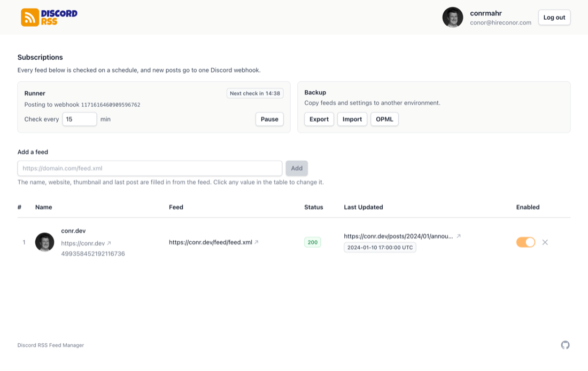
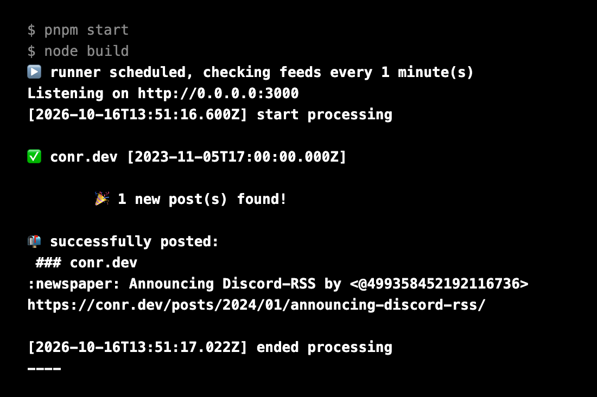
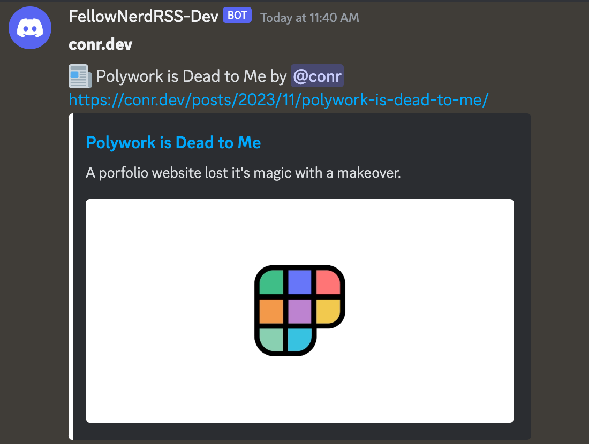

# Discord RSS Feed Manager (Forked)

Self-hosted RSS feed fetching and posting to Discord webhooks with web a management UI.

## Usage

### Development

- Install Node >=22 and pnpm, and run `pnpm install`.
- Run `pnpm run check` and `pnpm run dev`. The RSS poller runs inside the web server, but is off in dev so you don't post to Discord by accident; set `RUNNER_ENABLED=true` to turn it on.
- For production run `pnpm run build` and `pnpm run start`.

### Configuration

The service can be configured using environment variables:

- `INTERVAL` (default 15) minutes between checks
- `RUNNER_ENABLED` (default `true` in production, `false` in dev) whether the server polls feeds and posts to Discord
- `REDIS_URL` (required) redis connect url
- `DATABASE_NAME` (required) redis key the feed list is stored under
- `DISCORD_WEBHOOK_URL` (required) Discord webhook every feed posts to, e.g. `https://discord.com/api/webhooks/id/token`
- `AUTH_SECRET` (required) random generated secret
- `AUTH_TRUST_HOST` (required) boolean
- `AUTH_DISCORD_CLIENT_ID` (required) https://discord.com/developers/applications
  - Make sure to add `http://localhost:5173/auth/callback/discord`, or the production equivalant, to your OAuth2 redirects section.
- `AUTH_DISCORD_CLIENT_SECRET` (required) https://discord.com/developers/applications
- `DISCORD_AUTHORIZED_USERS` (required) comma-separated list of Discord user IDs for users allowed to access and modify the configuration

### Upgrading to v2

v2 posts every feed to one webhook instead of a webhook per feed. Set `DISCORD_WEBHOOK_URL` before deploying; feeds are not checked without it.

The RSS poller now runs inside the web server, so the separate runner service (`pnpm run runner`) is gone. Remove it from your deployment: its scripts no longer exist, and if you point it at `pnpm run start` instead, both services will poll and every post will be sent twice. Webhook URLs saved on existing feeds are ignored and removed the next time you save from the web interface.

### Railway

## Screenshots

## Credits

- [@3ventic](https://github.com/3ventic) For building the original version
- [@javorszky](https://github.com/javorszky) & [@cassidoo](https://github.com/cassidoo) For inspiration and putting it to good use
